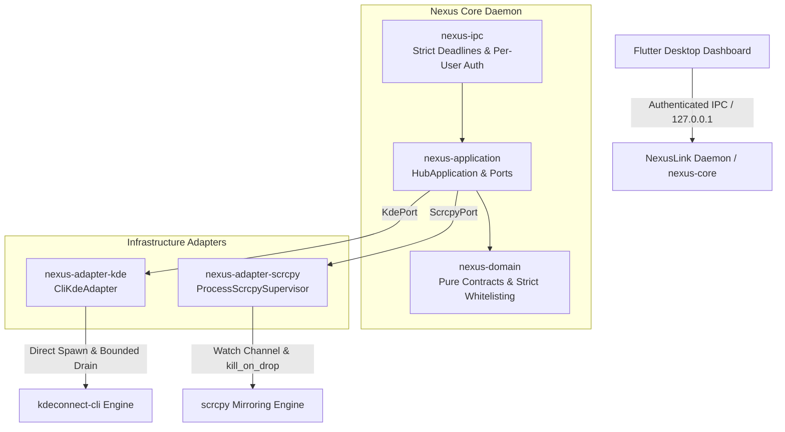

# NexusLink — Universal Device Integration Platform

[](https://github.com/abbasahmedpower/nexuslink-/actions/workflows/ci.yml)
[](LICENSE)
[](CHANGELOG.md)

**NexusLink** is a production-grade, local-first platform designed to seamlessly connect mobile devices with desktop workstations across Windows, Linux, and Android.

Instead of reinventing complex, fragile media encoding and networking stacks, NexusLink orchestrates mature, battle-tested upstream engines (`scrcpy` and `kdeconnect-cli`) as **strictly managed, supervised processes** behind a resilient **Hexagonal Rust Core** and a high-performance **Flutter Desktop GUI**.

---

## Architecture Overview

NexusLink separates domain contracts, application logic, and infrastructure adapters following Hexagonal / Ports & Adapters principles:



### Key Engineering Highlights

1. **Inverted Dependency Graph (Hexagonal Architecture)**:
   - `nexus-domain`: Pure data models, strict input validators, and error definitions.
   - `nexus-application`: Defines the ports (`KdePort`, `ScrcpyPort`, `DiscoveryProvider`) and business workflows.
   - `nexus-adapter-*`: Implement application ports independently. Application and core layers have zero dependency on concrete adapter internals.

2. **Race-Free Process Supervision**:
   - Replaced fragile notification primitives with `tokio::sync::watch` state channels.
   - Child processes are monitored in dedicated async tasks without holding locks during process execution.
   - Accurate, truthful state machine: introduces `SessionState::TerminationUnconfirmed` on timeout while preserving original process metadata (PID, serial, start time).
   - Configured with `kill_on_drop(true)` and unified `ShutdownCoordinator` to guarantee child termination on daemon exit.

3. **Continuous Bounded Output Capture**:
   - Standard output and error streams are captured up to strict limits (`MAX_CHILD_OUTPUT = 64 KB`, `MAX_OUTPUT_CAPTURE_SIZE = 12 KB`).
   - Sinks continuously drain remaining output to `/dev/null` using `tokio::io::copy`, eliminating pipe buffer deadlocks.

4. **Zero-Trust Per-User Loopback IPC**:
   - Bound exclusively to loopback (`127.0.0.1:8788`).
   - Session tokens generated via OS CSPRNG (`getrandom`) and stored with strict file ACLs (`0600` on Unix; explicit user-only ACL on Windows). Insecure shared temporary directory fallbacks are strictly rejected.
   - Constant-time XOR token verification prevents timing side-channel attacks.
   - Handshake deadline: Unauthenticated connections are dropped after 5 seconds.
   - Idle timeout: Inactive sockets are disconnected after 60 seconds.
   - Bounded frame parser enforces `MAX_IPC_FRAME_SIZE` (64 KiB) before memory allocation.
   - Automatic `ResyncRequired` event notification when event broadcast subscriber experiences lag.

5. **Conflict-Free Upstream Coexistence**:
   - Eliminated port collision on UDP 1716.
   - Removed invalid identity broadcasts advertising non-existent TCP listeners.
   - Passive discovery operates transparently alongside official KDE Connect daemons.

---

## Feature Matrix

| Feature | Status in v1.0.0 | Engine / Transport | Notes |
| :--- | :--- | :--- | :--- |
| **KDE Device Discovery** | Verified | `kdeconnect-cli` | Lists paired & reachable devices |
| **KDE Device Pairing** | Verified | `kdeconnect-cli` | Initiates pairing with mobile device |
| **KDE Device Ping** | Verified | `kdeconnect-cli` | Sends ping to test connectivity |
| **File & URL Sharing** | Verified | `kdeconnect-cli` | Shares files/links to paired phone |
| **Screen Mirroring** | Verified | `scrcpy` (Supervised) | Native window, low latency (60 FPS) |
| **Camera Streaming** | Verified | `scrcpy` (Supervised) | Uses device camera as input source |
| **Process State Tracking** | Verified | Rust `watch` Channel | Running, Stopped, Failed, Unconfirmed |
| **Secure IPC Transport** | Verified | `nexus-ipc` (Loopback) | CSPRNG token, handshake deadline |
| **Flutter Desktop UI** | Verified | Flutter 3.x | Real-time reactive dashboard |
| **Embedded In-Window Video** | *Roadmap (v1.1)* | `libscrcpy` / SDL | Direct video texture in Flutter view |
| **Direct KDE TLS Protocol** | *Roadmap (v1.2)* | Pure Rust TLS Engine | Native pairing without kdeconnectd |
| **Notification / SMS Mirror**| *Roadmap (v1.2)* | Desktop Notifications | System tray and interactive reply |
| **Android Companion App** | *Roadmap (v1.3)* | Native Kotlin | Custom APK for low-level controls |

---

## Getting Started

### Prerequisites

1. **Rust Toolchain**: 1.75 or later (`rustup install stable`)
2. **Flutter SDK**: 3.19 or later
3. **Upstream Tools** on system `PATH`:
   - `scrcpy` ([GitHub](https://github.com/Genymobile/scrcpy))
   - `kdeconnect-cli` ([KDE](https://github.com/KDE/kdeconnect-kde))
   - `adb` (Android Platform Tools)
4. **Python**: 3.10+ (for test suite and contract verification)

### Running the Rust Daemon

```bash
# Verify all workspace crates and unit tests
cargo test --workspace

# Start the core integration daemon
cargo run -p nexus-core
```

*The daemon generates a secure session token in your user runtime directory (`%LOCALAPPDATA%\NexusHub\run\nexus_ipc.token` on Windows or `$XDG_RUNTIME_DIR/nexus_hub/nexus_ipc.token` on Linux) and listens on `127.0.0.1:8788`.*

### Running the Flutter Dashboard

```bash
cd ui

# Fetch dependencies
flutter pub get

# Launch on desktop
flutter run -d windows   # On Linux: flutter run -d linux
```

---

## Verification & Testing

NexusLink includes a multi-tiered test suite guaranteeing structural compliance, contract validity, and runtime safety:

```bash
# 1. Check architectural boundary constraints
python scripts/check_structure.py

# 2. Check Rust formatting
cargo fmt --all -- --check

# 3. Static analysis and clippy checks
cargo clippy --workspace --all-targets -- -D warnings

# 4. Run Rust unit and integration tests
cargo test --workspace

# 5. Verify IPC and Domain contract tests
python scripts/test_v04_contracts.py
```

---

## Project Structure

```
├── .github/workflows/ci.yml       # Automated CI pipeline
├── crates/
│   ├── nexus-domain/              # Domain models, error codes, identifier validation
│   ├── nexus-application/         # Hexagonal application ports (KdePort, ScrcpyPort)
│   ├── nexus-adapter-kde/         # kdeconnect-cli execution and bounded capture
│   ├── nexus-adapter-scrcpy/      # Supervised scrcpy process lifecycle & watch channels
│   ├── nexus-ipc/                 # Authenticated TCP loopback IPC server & client protocol
│   └── nexus-core/                # Application composition, CLI entrypoint & signal handling
├── ui/                            # Flutter cross-platform desktop user interface
├── docs/                          # Architecture, Threat Model, and Upstream Integration docs
├── scripts/                       # Verification test runners and contract validators
├── LICENSE                        # Apache 2.0 License
├── SECURITY.md                    # Vulnerability reporting & security model
├── CONTRIBUTING.md                # Contribution guidelines
└── CHANGELOG.md                   # Detailed release notes
```

---

## Upstream Acknowledgments & Licenses

NexusLink builds upon the exceptional work of open-source projects:
- **scrcpy**: Developed by Genymobile (Apache 2.0).
- **KDE Connect**: Developed by the KDE Community (GPLv2+).

NexusLink interacts with these tools strictly via their public CLI interfaces as external managed child processes and does not link directly with GPL-licensed code.

---

## License

NexusLink is licensed under the [Apache License, Version 2.0](LICENSE).
